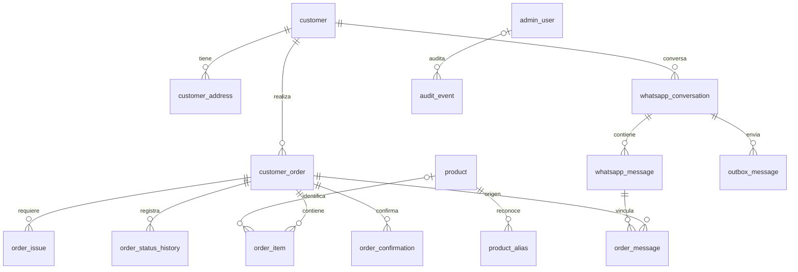

# Arquitectura y modelo inicial

Monolito modular: React consumirá la API REST de Spring Boot y el backend accederá
a PostgreSQL. WhatsApp entrará por un webhook verificado; los eventos se guardarán
antes de procesarlos. Un trabajador procesará entradas y otro enviará la outbox.
Estos trabajadores y el webhook todavía no están implementados.

Módulos previstos: `security`, `customer`, `product`, `order`, `whatsapp`,
`interpretation`, `audit` y `common`. Cada módulo de negocio contendrá `controller`,
`service`, `repository`, `entity` y `dto` según se implemente. Los controladores
no accederán directamente a repositorios y no se expondrán entidades JPA como API.

## Relaciones

El diccionario completo de columnas, índices y restricciones está en
`backend/src/main/resources/db/migration/V1__initial_schema.sql`.

## Decisiones del modelo

- UUID para identificadores; número de pedido secuencial independiente. Puede
  tener saltos y no representa una numeración fiscal.
- Fechas `TIMESTAMPTZ`; interfaz futura en `America/Argentina/Buenos_Aires`.
- Importes `NUMERIC(14,2)`, cantidades `NUMERIC(12,3)` y moneda ARS.
- Precio o total desconocido: `NULL`. No se sustituye por cero.
- Teléfono normalizado e identificador de WhatsApp únicos cuando existen.
- Dirección y contacto copiados al pedido para conservar su historia.
- Cantidad solicitada separada de la cantidad en unidad de venta. Solo se
  convierten unidades compatibles; nunca unidades de fruta a kg por suposición.
- Productos desconocidos pueden conservarse como líneas pendientes con texto
  original y `product_id` nulo hasta resolver la incidencia.
- Precios, nombres y unidades se congelarán al confirmar mediante el servicio de
  pedidos. Cambiar el catálogo no actualizará las líneas históricas.
- Estados operativos separados de la validación. Los códigos de la base se
  traducirán al español en la interfaz.
- Claves únicas de mensajes y eventos protegen contra duplicados. Un evento de
  estado de entrega deberá tener una clave distinta del evento de mensaje.
- Outbox transaccional para evitar perder notificaciones. Su clave interna no
  garantiza entrega exactamente una vez en Meta: un envío con resultado incierto
  debe reconciliarse o revisarse antes de reintentarlo.
- `locked_at` permite recuperar trabajos interrumpidos; los trabajadores deberán
  implementar adquisición atómica, vencimiento de bloqueos y límite de reintentos.
- Campos `version` preparados para bloqueo optimista JPA.

## Reglas que implementará la capa de servicios

Las restricciones SQL son una primera defensa. Confirmar exigirá al menos una
línea resuelta, productos disponibles, datos de entrega completos, ausencia de
incidencias abiertas y suma consistente de subtotales. También se validarán las
transiciones de estado, las revisiones y la inmutabilidad de precios confirmados.
Estas reglas aún no tienen endpoints ni servicios y no se dan por implementadas.

Contraseñas con BCrypt, sesión con CSRF y autorización de administradores.
Las rutas de negocio requieren sesión con rol ADMIN. El alta inicial se habilita
solo explícitamente por entorno; ver `autenticacion.md`. Los datos personales de
mensajes, payloads y auditoría requerirán política de retención, acceso restringido
y exclusión de logs. Las credenciales vendrán de variables de entorno.

## Estado y siguientes etapas

1. Autenticación y alta controlada del primer administrador: implementadas.
2. Frontend React, TypeScript y Tailwind: login y estructura del panel.
3. Entidades, DTO, servicios y API para productos y clientes, con sus pantallas.
4. Pedidos manuales, cálculos, confirmación e historial.
5. Webhook Meta, firma, eventos idempotentes y procesamiento persistente.
6. Interpretación conservadora, aclaraciones y mensajes según reglas vigentes de Meta.
7. Pruebas de integración completas, despliegue HTTPS, respaldos y restauración.

Spring Boot 4.1.1 fue seleccionado según la documentación oficial consultada:
https://docs.spring.io/spring-boot/system-requirements.html
